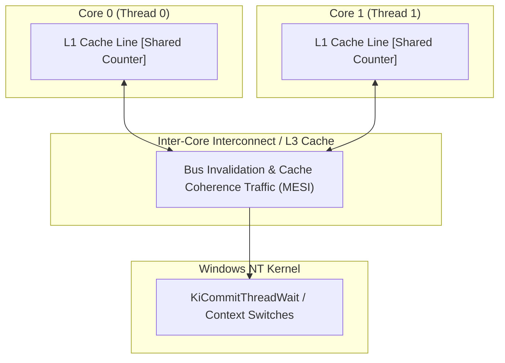
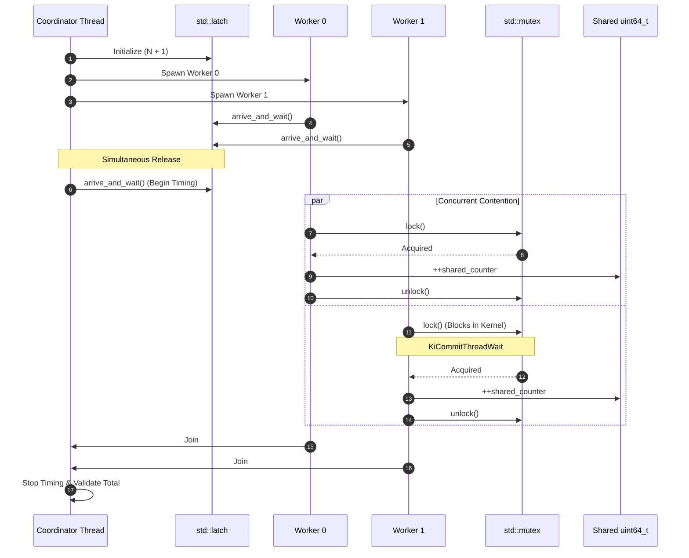
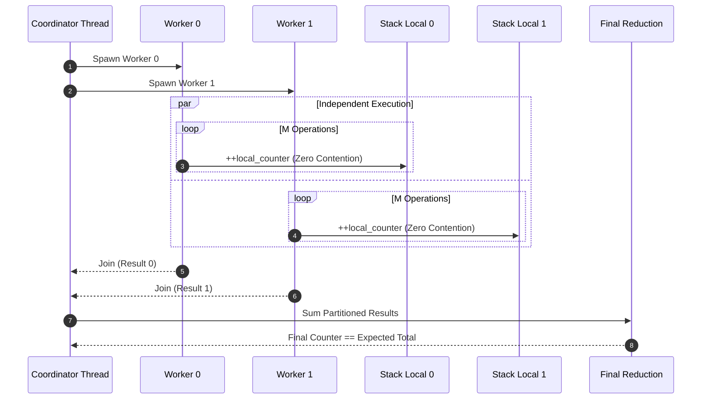

# Windows Performance Investigation Lab

[](.github/workflows/windows-ci.yml)
[](https://en.cppreference.com/w/cpp/20)
[](https://microsoft.com)
[](https://learn.microsoft.com/en-us/windows/win32/etw/event-tracing-portal)

A native Windows C++20 systems engineering investigation project designed to reproduce, measure, and analyze multi-threaded synchronization bottlenecks and CPU lock contention using native **Event Tracing for Windows (ETW)**, **Windows Performance Recorder (WPR)**, and **Windows Performance Analyzer (WPA)**.

---

## Table of Contents

- [1. Project Objective](#1-project-objective)
- [2. Why Lock Contention Matters](#2-why-lock-contention-matters)
- [3. Architecture Overview](#3-architecture-overview)
  - [Baseline Architecture (Contended Mutex)](#baseline-architecture-contended-mutex)
  - [Optimized Architecture (Thread-Local Reduction)](#optimized-architecture-thread-local-reduction)
- [4. Event Tracing for Windows (ETW) Instrumentation](#4-event-tracing-for-windows-etw-instrumentation)
- [5. System Requirements](#5-system-requirements)
- [6. Build Instructions](#6-build-instructions)
- [7. Command-Line Interface (CLI)](#7-command-line-interface-cli)
- [8. Benchmark Methodology](#8-benchmark-methodology)
- [9. WPR Trace Capture Instructions](#9-wpr-trace-capture-instructions)
- [10. WPA Analysis Instructions](#10-wpa-analysis-instructions)
- [11. CSV Schema & Output Format](#11-csv-schema--output-format)
- [12. Testing & Verification](#12-testing--verification)
- [13. Known Limitations](#13-known-limitations)
- [14. References & Further Reading](#14-references--further-reading)

---

## 1. Project Objective

In high-concurrency systems programming, adding more CPU cores frequently fails to improve throughput when applications suffer from synchronization bottlenecks. When multiple threads contend for shared synchronization primitives, hardware cache coherence protocols and kernel context switches rapidly degrade performance.

The **Windows Performance Investigation Lab** provides:
1. **Deterministic Bottleneck Reproduction**: A baseline workload demonstrating severe `std::mutex` contention on a shared 64-bit counter.
2. **Optimized Concurrency Workload**: A functionally equivalent implementation using thread-local reduction, eliminating cross-thread synchronization.
3. **Native ETW Instrumentation**: A dedicated `TraceLogging` provider emitting workload and worker lifecycle events directly into Windows kernel event streams.
4. **WPR Tracing Profiles**: Custom `.wprp` configuration capturing kernel CPU sampling, thread scheduling (`CSwitch`), and custom ETW events.
5. **In-Depth WPA Analysis**: Comprehensive documentation and procedures for inspecting trace graphs in Windows Performance Analyzer.
6. **Reproducible Benchmarks**: Statistical aggregation (mean, median, min, max, throughput) exported to structured CSV and summary reports.

---

## 2. Why Lock Contention Matters

At the hardware level, modern multi-core x86-64 processors enforce cache coherence across L1/L2/L3 caches via variants of the **MESI** (Modified, Exclusive, Shared, Invalid) protocol.



When multiple worker threads attempt to write to the same memory location guarded by a mutex:
- **Cache Line Bouncing**: Each lock acquisition requires exclusive ownership of the cache line containing the mutex and counter. As different cores acquire the lock, the cache line must be continuously invalidated and transferred across CPU interconnects, creating immense memory bus pressure.
- **Kernel Wait Transitions**: When a thread fails to acquire the mutex in user space, MSVC's runtime transitions the thread into a kernel wait (`ntdll.dll!WaitOnAddress` or `ntdll.dll!RtlpWaitOnCriticalSection`), invoking `ntoskrnl.exe!KiCommitThreadWait`.
- **Involuntary Context Switches**: The Windows scheduler deschedules the contending thread and switches to another ready thread, causing CPU instruction pipeline stalls, register state flushes, and TLB (Translation Lookaside Buffer) misses.

---

## 3. Architecture Overview

### Baseline Architecture (Contended Mutex)

In the baseline implementation (`ContendedWorkload`), $N$ worker threads execute concurrently. All threads increment a single shared 64-bit counter protected by a common `std::mutex`.



### Optimized Architecture (Thread-Local Reduction)

In the optimized implementation (`OptimizedWorkload`), each worker increments its own private counter stored on its thread stack (`volatile uint64_t local_counter`). After all threads complete, the coordinator aggregates each partitioned counter into the final total.



---

## 4. Event Tracing for Windows (ETW) Instrumentation

The application integrates native ETW via Microsoft's **TraceLogging** framework (`<TraceLoggingProvider.h>`).

### Provider Details
- **Provider Name**: `Shivam.PerformanceInvestigationLab`
- **Provider GUID**: `{b0ee99b7-9835-4d51-933a-df6647dbd99f}`
- **Registration**: Managed via RAII class [`EtwProvider`](file:///Users/shivam/Open-Source/Windows-Performance-Investigation-Lab/include/diagnostics/etw_provider.h). Automatically registers on startup and unregisters on destruction.
- **Fail-Safe Operation**: If running without elevated tracing privileges or on a non-Windows host, ETW registration safely degrades to inactive without interrupting benchmark execution.

### Emitted Events

| Event Name | Level | Payload Fields | Purpose |
| :--- | :--- | :--- | :--- |
| `WorkloadStarted` | Informational | `WorkloadMode`, `ThreadCount`, `OperationsPerWorker`, `TotalOperations` | Marks physical start of workload execution. |
| `WorkerStarted` | Informational | `WorkloadMode`, `WorkerId`, `OperationsPerWorker` | Emitted when an individual worker thread begins. |
| `WorkerCompleted` | Informational | `WorkloadMode`, `WorkerId`, `OperationsCompleted`, `ElapsedMilliseconds` | Emitted when a worker finishes its loop. |
| `WorkloadCompleted`| Informational | `WorkloadMode`, `ThreadCount`, `TotalOperations`, `FinalCounter`, `ElapsedMilliseconds`, `Success` | Emitted after all workers join; verifies counter validity. |
| `BenchmarkRunCompleted` | Informational | `WorkloadMode`, `RunNumber`, `TotalRuns`, `ElapsedMilliseconds`, `OperationsPerSecond`, `Success` | Emitted at the conclusion of each measured benchmark run. |

---

## 5. System Requirements

- **Operating System**: Windows 10 (version 1809+) or Windows 11 x64.
- **Compiler**: Microsoft Visual Studio 2022 (MSVC v143 toolchain) or higher with C++20 standard support.
- **Build System**: CMake 3.20 or newer.
- **Profiling Tools (Optional for Tracing)**: Windows Performance Toolkit (WPR and WPA), included in the [Windows Assessment and Deployment Kit (Windows ADK)](https://learn.microsoft.com/en-us/windows-hardware/get-started/adk-install).

---

## 6. Build Instructions

### Using PowerShell Helper Script
```powershell
# Build Release configuration and run CTest suite
.\scripts\build.ps1 -Configuration Release -RunTests
```

### Manual Build with CMake
```cmd
# Configure CMake for Visual Studio 2022 x64
cmake -B build -S . -DCMAKE_BUILD_TYPE=Release

# Build the Release binary
cmake --build build --config Release --parallel

# Execute unit test suite with CTest
ctest --test-dir build -C Release --output-on-failure
```

---

## 7. Command-Line Interface (CLI)

The benchmark executable is [`perf_lab.exe`](file:///Users/shivam/Open-Source/Windows-Performance-Investigation-Lab/src/main.cpp).

```
Windows Performance Investigation Lab - CLI
Usage: perf_lab.exe [options]

Options:
  --mode <mode>         Workload execution mode:
                          baseline  : Contended mutex counter
                          optimized : Thread-local counter reduction
                          compare   : Run both and compare (default)
  --threads <N>         Number of worker threads (default: hardware concurrency)
  --operations <N>      Number of operations per worker thread (default: 1,000,000)
  --runs <N>            Number of benchmark iterations to measure (default: 5)
  --output-dir <path>   Directory where CSV and summary are saved (default: results)
  -h, --help            Display this help message and exit
  -v, --version         Display application version and exit
```

### Example Invocations

```cmd
# Compare baseline vs optimized with 8 threads and 2,000,000 operations per thread
perf_lab.exe --mode compare --threads 8 --operations 2000000 --runs 5

# Run baseline contended workload only
perf_lab.exe --mode baseline --threads 16 --operations 1000000 --runs 3

# Run optimized workload with custom results directory
perf_lab.exe --mode optimized --threads 16 --operations 5000000 --runs 5 --output-dir my_results
```

---

## 8. Benchmark Methodology

To ensure measurement accuracy and eliminate microbenchmarking pitfalls, the benchmark engine enforces:
1. **Coordinated Thread Release**: Uses `std::latch` so all threads begin contending at the exact same physical moment, eliminating thread-spawning timing skew.
2. **Warm-Up Execution**: Runs one complete unrecorded cycle prior to measurement to resolve page faults, prime CPU caches, and transition CPU cores to active frequency states.
3. **Monotonic Timing**: Measures elapsed duration using `std::chrono::steady_clock` (which maps to `QueryPerformanceCounter` on Windows).
4. **Resilient Statistics**: Computes both arithmetic **mean** and **median** values across measured runs to minimize the impact of operating system scheduling jitter.
5. **No Optimization Elision**: Uses `volatile` local accumulators in the optimized path to prevent compilers from collapsing the loop to an arithmetic constant ($O(1)$).

For detailed scientific rationale, see [Benchmark Methodology](docs/benchmark_methodology.md).

---

## 9. WPR Trace Capture Instructions

Trace capture requires elevated (Administrator) privileges to enable kernel event logging.

```powershell
# Open an elevated PowerShell session and execute:
.\scripts\capture_trace.ps1 -Mode baseline -Threads 8 -Operations 1000000
```

### Script Execution Flow
1. Verifies that `wpr.exe` and `config\PerformanceLab.wprp` exist.
2. Detects and safely cancels any orphaned tracing sessions.
3. Starts kernel and user-mode collectors:
   ```cmd
   wpr.exe -start config\PerformanceLab.wprp!PerformanceLabProfile -filemode
   ```
4. Executes `perf_lab.exe` under active trace.
5. Stops recording and merges events into `results\trace_<mode>.etl`.
6. Safe cleanup: if an error occurs, `wpr.exe -cancel` is automatically invoked in the `catch` block to avoid leaving tracing active.

---

## 10. WPA Analysis Instructions

To analyze the captured `.etl` trace in Windows Performance Analyzer:

```cmd
wpa.exe results\trace_baseline.etl
```

### Analysis Steps
1. **Configure Symbols**: In WPA, navigate to `Trace` -> `Configure Symbol Paths` and add Microsoft's public symbol server: `srv*C:\Symbols*https://msdl.microsoft.com/download/symbols`.
2. **Inspect Application ETW Events**:
   - In the Graph Explorer, open `System Activity` -> `Generic Events`.
   - Filter by `Provider Name: Shivam.PerformanceInvestigationLab`.
   - Zoom into the time range between `WorkloadStarted` and `WorkloadCompleted`.
3. **Examine Synchronization Contention**:
   - Open `Computation` -> `CPU Usage (Precise)`.
   - Notice the high context switch frequency and call stacks entering `ntoskrnl.exe!KiCommitThreadWait` through `ntdll.dll!WaitOnAddress` or `ntdll.dll!RtlpWaitOnCriticalSection`.
4. **Compare with Optimized Trace**:
   - Open `results\trace_optimized.etl`. Notice context switches drop to near zero and worker threads remain actively executing instructions on dedicated cores.

For comprehensive step-by-step guidance, refer to the [WPA Trace Analysis Guide](docs/trace_analysis.md).

---

## 11. CSV Schema & Output Format

All measured benchmark runs are recorded in `results/benchmark_results.csv`:

```csv
timestamp_utc,workload,threads,operations_per_worker,total_operations,run_number,elapsed_ms,operations_per_second,final_counter,success
2026-11-08T00:15:30Z,baseline,8,1000000,8000000,1,185.420,43145291.77,8000000,true
2026-11-08T00:15:30Z,baseline,8,1000000,8000000,2,182.115,43928287.07,8000000,true
2026-11-08T00:15:31Z,optimized,8,1000000,8000000,1,1.890,4232804232.80,8000000,true
2026-11-08T00:15:31Z,optimized,8,1000000,8000000,2,1.885,4244031830.24,8000000,true
```

In addition, human-readable summary reports are generated in `results/benchmark_summary.txt`:
```
================================================================================
                 WINDOWS PERFORMANCE INVESTIGATION LAB - SUMMARY
================================================================================
Timestamp UTC       : 2026-11-08T00:15:31Z
Workload Mode       : compare
Thread Count        : 8
Operations / Worker : 1000000
Total Logical Ops   : 8000000
Measured Runs       : 5
Overall Status      : PASSED
--------------------------------------------------------------------------------

Workload                             Mean (ms)   Median (ms)      Min (ms)      Max (ms)      Mean Ops/Sec    Median Ops/Sec
----------------------------------------------------------------------------------------------------------------------------
Baseline (Contended Mutex)              183.77        182.95        181.10        186.20          43532677          43727794
Optimized (Thread-Local Reduction)        1.88          1.88          1.85          1.91        4255319148        4255319148
----------------------------------------------------------------------------------------------------------------------------

COMPARATIVE ANALYSIS:
--------------------------------------------------------------------------------
Throughput Speedup Factor : 97.75x
Latency Reduction         : 98.98%
Execution Time Ratio      : 97.75x faster

Note: All values are derived from actual system clock measurements taken during
this benchmark run without artificial extrapolation.
================================================================================
```

---

## 12. Testing & Verification

The project includes unit test suites registered with **CTest**:

```cmd
# Run tests from the build directory
ctest --test-dir build -C Release --output-on-failure
```

### Covered Test Areas
- **Workload Correctness (`perf_lab_workload_tests`)**:
  - Single-thread and multi-thread baseline counter correctness.
  - Single-thread and multi-thread optimized counter correctness.
  - Strict mathematical equivalence of total logical work.
  - Rejection of invalid thread or operation configurations.
- **CLI Parsing & Validation (`perf_lab_cli_tests`)**:
  - Strict validation of command line arguments and boundary limits.
  - Rejection of non-numeric, negative, or overflow parameters.
  - Rejection of illegal filesystem characters in output directories.
  - Help and version flag handling.
- **Benchmark Engine & Statistics (`perf_lab_benchmark_tests`)**:
  - Mean, median, minimum, and maximum calculation on odd and even datasets.
  - CSV report header and row schema validation.
  - Mock ETW provider verification of lifecycle event counts.

---

## 13. Known Limitations

1. **Non-Windows Execution**: The application compiles and runs unit tests on POSIX/macOS platforms for cross-platform validation. However, ETW events and WPR tracing are native Windows kernel capabilities and are automatically disabled on non-Windows hosts.
2. **Hardware Concurrency & SMT**: On CPUs with simultaneous multithreading (Intel Hyper-Threading / AMD SMT), logical cores share execution units and L1/L2 caches. Running with thread counts exceeding physical core count may introduce hardware resource sharing effects separate from lock contention.
3. **Core Pinning / Affinity**: The benchmark currently allows the Windows scheduler to dispatch threads to any available core. On hybrid architectures (such as Intel 12th+ Gen Performance vs. Efficient cores), core affinity settings may influence execution speed.

---

## 14. References & Further Reading

- [Event Tracing for Windows (ETW) Documentation](https://learn.microsoft.com/en-us/windows/win32/etw/event-tracing-portal)
- [TraceLogging for C/C++ (Microsoft Learn)](https://learn.microsoft.com/en-us/windows/win32/tracelogging/trace-logging-portal)
- [Windows Performance Toolkit Technical Reference](https://learn.microsoft.com/en-us/windows-hardware/test/wpt/)
- [Modern C++ Concurrency (std::jthread, std::latch)](https://en.cppreference.com/w/cpp/thread)
